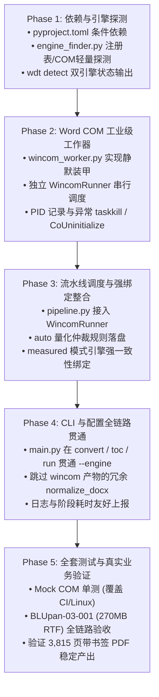

# Windows Doc Tool (wdt) - WinCOM 双引擎架构集成开发计划 (v2.0 修订版)

> **文档版本**: v2.0.0 (已根据评审意见全面修订)  
> **修订日期**: 2026-10-30  
> **状态**: 待执行 (Ready for Implementation)  
> **目标模块**: `pyproject.toml`, `src/wdt/core/engine_finder.py`, `src/wdt/core/wincom_worker.py`, `src/wdt/core/batch_runner.py`, `src/wdt/pipeline.py`, `src/wdt/main.py`

---

## 1. 背景与核心目标

### 1.1 业务背景
在临床试验生物统计与医学写作交付场景中，典型的交付单元为 **1 个汇总表 (Table, Section 14)** + **1 个受试者列表 (Listing, Section 16.2)**。
经真实业务数据（`BLUpan-03-001[28OCT26]_Listing.DOC`，270MB RTF，3,815 页，2.6 万个表格）实测验证：
- **`wdt`（便携 LibreOffice 沙箱）优势**：转码 DOCX 体积精简（7.3MB vs 17.5MB），TOC 字节流注入秒级完成（13.8s），零环境依赖；
- **`wdt` 劣势**：LibreOffice 排版引擎在面对数千页超大跨页表格时，由于多遍排版约束求解算法复杂度急剧上升，导出 PDF 发生超时（>34.5 分钟）；
- **`wincom`（Word COM 自动化）优势**：微软 Word 针对超大高密表格具有专用流式排版优化，**19.9 分钟即可稳定导出 3,815 页带书签 PDF**。

### 1.2 核心目标
将 Microsoft Word COM 自动化（`wincom`）作为原生后端整合进 `wdt`，打造 **双引擎架构（Dual-Engine Architecture）**：
1. **多后端支持**：支持 `libreoffice`、`wincom` 与 `auto` 智能切换；
2. **彻底攻克超大 PDF 渲染**：解决 3,000+ 页巨型 Listing 导出 PDF 超时的问题；
3. **强化安全护栏**：吸取 `wdt` 的沙箱设计思想，给 Word COM 穿上“工业级装甲”（禁用一切弹窗、禁用宏安全拦截、进程树保底清理，杜绝僵尸 `WINWORD.EXE`）；
4. **统一用户交互**：保持既有 CLI (`wdt convert`, `wdt toc`, `wdt run`) 与 GUI 的统一操作体验，不破坏任何现有参数。

---

## 2. 针对评审意见的四个关键设计补全

### 2.1 补全 1：WinCOM 与 BatchRunner 的并发模型解耦（架构闭环）

#### 痛点根因
`BatchRunner.convert()` 的核心基于 `ProcessPoolExecutor` 多进程分块调度，并依赖 LibreOffice 专有的独立沙箱 UserInstallation (`worker_id`)。
COM 对象无法跨进程 pickling 传递，且 Windows 下若启动 4~8 个并发 `WINWORD.EXE` 处理几百兆的 Listing，内存会瞬间被撑爆（单进程 4.3GB $\times 4 \approx 17.2$GB），引发严重 OOM 甚至系统宕机。

#### 解决方案：双调度器解耦 + 共享 `FileResult` 契约
不强行将 COM 塞入 `ProcessPoolExecutor`，而是定义独立调度器：
1. **`BatchRunner` (保留不变)**：专职负责 LibreOffice 多进程分块并行调度；
2. **新增 `WincomRunner`**：
   - **串行执行保证（Jobs 强制为 1）**：专为单机 Word 自动化设计，采用受控的单进程/单 Word 实例串行任务队列，杜绝多开 Word 抢占内存；
   - **单实例复用与单文件隔离**：默认复用同一个后台受控 `WINWORD.EXE` 实例以降低启动销毁开销；若单文件转换发生严重异常或超时查杀，自动重置并重新拉起新实例；
   - **契约对齐**：完全复用 `wdt.core.converter_worker.FileResult` 数据结构，对外暴露与 `BatchRunner` 一致的调用签名：
     ```python
     def convert(
         self,
         pairs: Sequence[tuple[Path, Path]],
         target: Literal["docx", "pdf"],
         progress_cb: Callable[[int, int, FileResult], None] | None = None,
         should_cancel: Callable[[], bool] | None = None,
     ) -> list[FileResult]: ...
     ```
3. **调度入口分流**：
   在 `pipeline.py` 中，根据决议出的引擎类型实例化对应的 Runner：
   - 目标为 `libreoffice` 时实例化 `BatchRunner`；
   - 目标为 `wincom` 时实例化 `WincomRunner`。

---

### 2.2 补全 2：STATIC_MEASURED 模式下的排版引擎强绑定约束

#### 痛点根因
`pipeline.py` 的 `_perform_page_measurement()` 通过导出临时 PDF 来实测标题锚点的物理页码并回写 DOCX。
LibreOffice 与 Microsoft Word 在字体渲染、行距留白、表格跨页计算上存在明显差异（实测同一文档 LO 估算 3,788 页，Word 实际 3,815 页）。如果测量临时 PDF 用了 LO，而最终 PDF 渲染用了 Word，将直接造成 TOC 目录页码与 PDF 物理页码错位。

#### 解决方案：全生命周期引擎绑定
1. **测量与终导强一致性保证**：
   在 `pipeline.py` 中增加约束：`_perform_page_measurement` 所使用的 PDF 转换器必须与流水线最终的 PDF 渲染引擎严格相同。
2. **执行映射**：
   - 若最终 PDF 渲染走 `wincom`，则临时测量 PDF 必须通过 `WincomRunner` 导出；
   - 若最终 PDF 渲染走 `libreoffice`，则临时测量 PDF 必须通过 `BatchRunner` 导出；
   - 彻底杜绝“LO 测量 + Word 渲染”或“Word 测量 + LO 渲染”的跨引擎状态。

---

### 2.3 补全 3：`auto` 智能仲裁策略与量化阈值定义

#### 先验特征与约束分析
在文档未被打开排版前，总页数属于未知量。可靠的先验特征仅有：磁盘文件大小（`path.stat().st_size`）与文件真实嗅探格式（`sniff(path)`: rtf / doc / docx）。
同时基准测试证明：Word 转换出的 DOCX 约为 LO 的 2.4 倍（17.5MB vs 7.3MB）。因此在仅需 DOCX 且体积适中时，应尽量走 LO 以保护产物体积优势；在涉及超大文件 PDF 导出时，必须坚决走 Word COM 以防超时。

#### 量化决策规则与可调参数
定义常量（置于 `wdt.core.engine_finder` 或模块常量配置）：
```python
WINCOM_PDF_RTF_THRESHOLD_MB = 50.0    # 导出 PDF 时，RTF/DOC 大文件阈值
WINCOM_PDF_DOCX_THRESHOLD_MB = 100.0  # 导出 PDF 时，DOCX 大文件阈值
WINCOM_DOCX_ONLY_THRESHOLD_MB = 150.0 # 仅转 DOCX 时，避免 LO 内存膨胀的阈值
```

决策树（顺序评估）：
1. **前置可用性**：系统须为 `sys.platform == 'win32'` 且已检测到 `WordEngine.available == True`。若未满足，`auto` 100% 走 `libreoffice`。
2. **规则 A（涉及 PDF 导出: `make_pdf=True`）**：
   - 若 `sniff(file) in ("rtf", "doc")` 且单文件 $\ge 50$ MB $\to$ **路由至 `wincom`**（彻底避开 LO 巨型表格排版超时）；
   - 若单文件 $\ge 100$ MB（任意格式） $\to$ **路由至 `wincom`**；
   - 其余中小文件（$< 50$ MB） $\to$ **路由至 `libreoffice`**（并发快速、免开 Word）。
3. **规则 B（仅转 DOCX: `make_docx=True, make_pdf=False`）**：
   - 默认走 `libreoffice`（享受 7.3MB vs 17.5MB 的紧凑体积与多进程加速）；
   - 仅当单文件 $\ge 150$ MB 时 $\to$ **路由至 `wincom`**（避免 LO 内部 DOM 树消耗 >4.8GB 内存）。
4. **规则 C（同批次排版一致性）**：
   在处理“1 Table + 1 Listing”批次时，若 Listing 触发了 `wincom` 规则且任务含 PDF，同批次的 Table 一并升级为 `wincom` 渲染，确保两个文档的 TOC 字体、段落间距及 PDF 渲染引擎的一致性。

---

### 2.4 补全 4：`pywin32` 平台条件依赖与跨平台安全隔离

#### 依赖声明 (`pyproject.toml`)
严格遵循 PEP 508 环境标记规范：
```toml
dependencies = [
    "pypdf>=4.0",
    "pywin32>=306; sys_platform == 'win32'",
]
```

#### 代码级软隔离 (`wdt.core.wincom_worker`)
在非 Windows 系统（Linux / macOS / CI）或未安装 `pywin32` 的环境中：
- `import win32com.client` 放在模块级 `try ... except ImportError` 块内；
- 暴露 `is_wincom_supported() -> bool` 判定函数；
- 若在不支持的环境下强行调用 `WincomRunner`，抛出清晰明了的 `NotImplementedError("Word COM 引擎仅支持 Windows 环境且需安装 pywin32")`，确保 CI 自动化测试与跨平台导入绝不崩盘。

---

## 3. 次要问题防护细节

1. **`wdt toc` 子命令贯通 `--engine`**：
   由于 `wdt toc --page-mode measured` 内部需导出临时 PDF，CLI 必须支持 `--engine {auto,libreoffice,wincom,lo,com}`，并在 `measured` 模式下将选定引擎传递给 `_perform_page_measurement`。
2. **`run_pipeline` 签名平滑演进与 GUI 兼容**：
   - 保持 `run_pipeline(files, options, progress_cb, should_cancel, engine=None)` 原生签名不变（`engine` 参数继续承载默认的 LO 引擎）；
   - 在 `PipelineOptions` 中增加 `engine_mode: Literal["auto", "libreoffice", "wincom"] = "auto"`；
   - GUI（`PipelineWorker`）完全无需修改参数传递结构，只需在构造 `options` 时挂载用户的引擎偏好。
3. **超时查杀与 COM 悬空指针保护**：
   - 设定针对超大 PDF 渲染的保底超时（默认 1,800 秒 / 30 分钟）；
   - 异常处理机制：若调用 `taskkill /PID <pid> /T /F` 强制终止了 `WINWORD.EXE`，在 Python 侧**严禁继续调用任何已被断开的 COM 代理对象**（避免触发 `RPC_E_DISCONNECTED`），必须立刻重置 `doc = None; word = None`，并调用 `pythoncom.CoUninitialize()`，保证主进程无泄漏。
4. **跳过无谓的 DOCX 规范化**：
   Word COM 导出的 DOCX 属于微软原生合规文档，不包含 LibreOffice 生成的特殊 XML 命名空间问题，因此在 `wincom` 转码后**显式跳过 `normalize_docx` 流程**，避免对数十兆 ZIP 包进行解压再重压缩的 IO 浪费。

---

## 4. 实施阶段与排期 (Implementation Phases)



---

## 5. 验收标准 (Acceptance Criteria)

1. **环境诊断测试**：
   在 Windows 终端运行 `uv run wdt detect`，能清晰打印 LibreOffice 和 Word 16.0 状态，且推荐引擎符合安装实际。
2. **自动化测试集**：
   `uv run pytest tests/` 全部通过，在无 Office 的环境上通过 Mock 完整测试异常降级与取消逻辑。
3. **真实极限验收**：
   针对 `BLUpan-03-001[28OCT26]_Listing.DOC`，执行：
   ```bash
   wdt run "C:\Users\ChaoCheng成超\Desktop\BLUpan-03-001[28OCT26]_Listing.DOC" --pdf --engine auto -o ./output
   ```
   **判定通过条件**：
   - 自动决策路由至 `wincom` 引擎；
   - 进程全程无任何弹窗中断；
   - 稳定输出完整 DOCX 与 **3,815 页 PDF**，PDF 内含 48 个 Section 16.2 目录书签；
   - 运行结束后任务管理器无残留僵尸 `WINWORD.EXE` 进程。
